# kicad-analysis-suite

**PCB Analysis Suite for KiCad**: a KiCad 10 plugin, also usable standalone, for analysing printed circuit boards. It has three tools so far:

- **DC & Thermal**: current density, IR drop and temperature on a real board, including resistance elements, current pulses (fusing) and magnetic field maps.
- **Trace R/L/C → SPICE**: R, L, C, Z₀ and delay of the copper between any pads, from a 2D field solve of each cross-section, exported as a SPICE RLC subcircuit.
- **Matching & Tolerance**: draw an RF matching network with real parts, then see whether it still meets its specs across part tolerances.

More tools (PDN, 3D extraction, full-wave export, signal integrity) are planned. See the [roadmap](docs/ROADMAP.md).

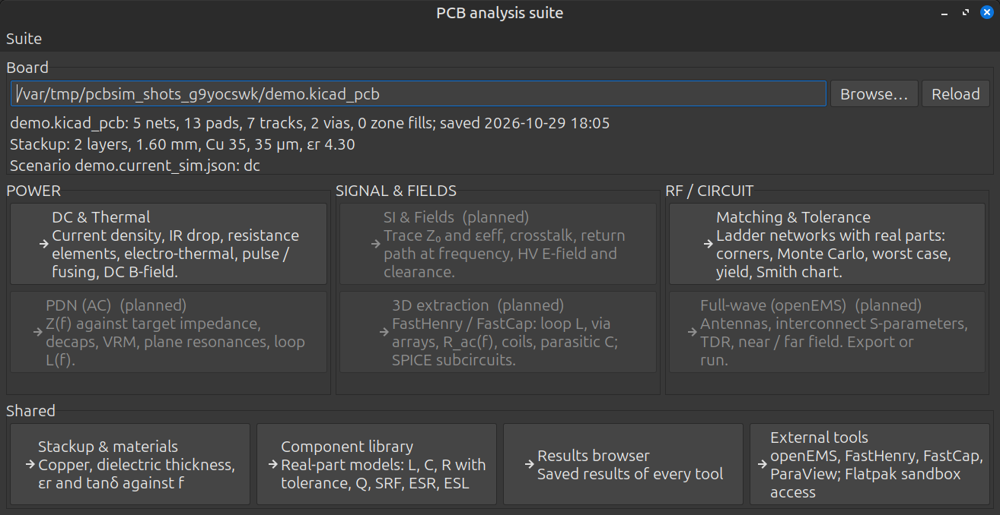

## DC & Thermal

Pick the pads where current enters and leaves, or add voltage sources and loads, and solve all of them together on the board's copper.

| Current density | Temperature (electro-thermal) |
|---|---|
| 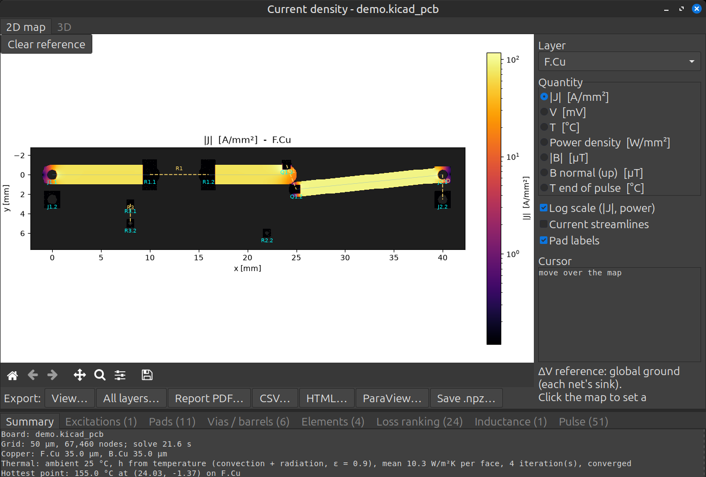 | 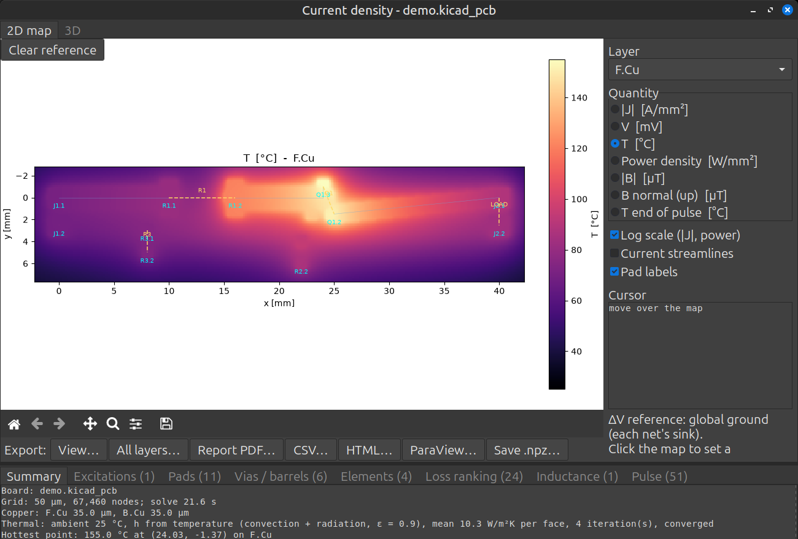 |
| **Magnetic field above the board** | **3D view** |
| 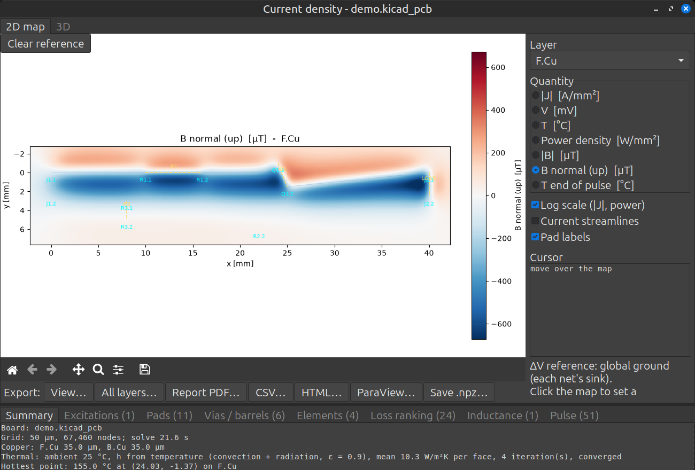 | 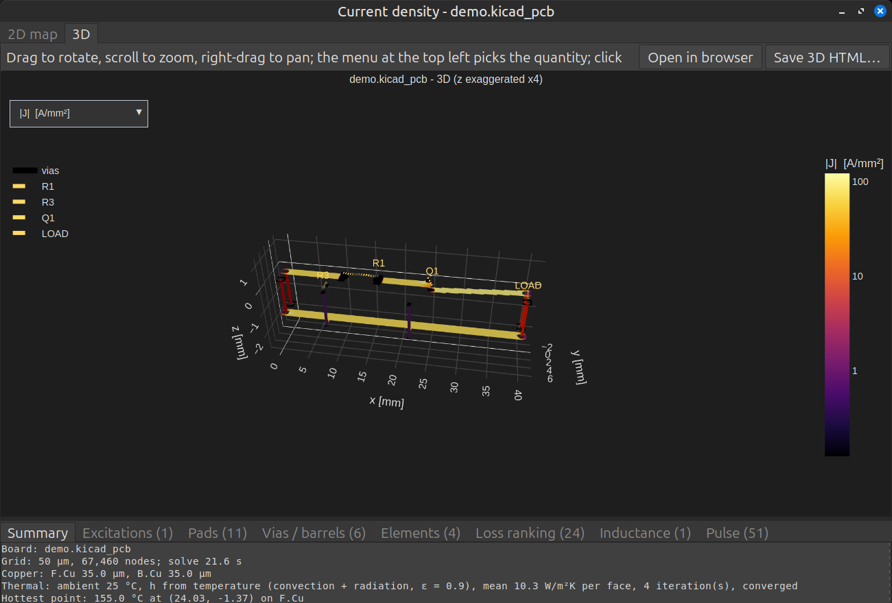 |

- Reads tracks, arcs, vias, filled zones, pads and the stackup directly from the `.kicad_pcb` file.
- Current paths, loads and voltage sources. Resistors on the board are found automatically, and any two pads can be joined by a resistance (FET R_on, inductor DCR, external load).
- Electro-thermal coupling with temperature-dependent copper resistance and natural convection plus radiation.
- Pulse heating and fusing, magnetic field maps and loop inductance.
- Tables per pad, via, track and element; export to PDF, HTML, CSV, PNG/SVG and ParaView.

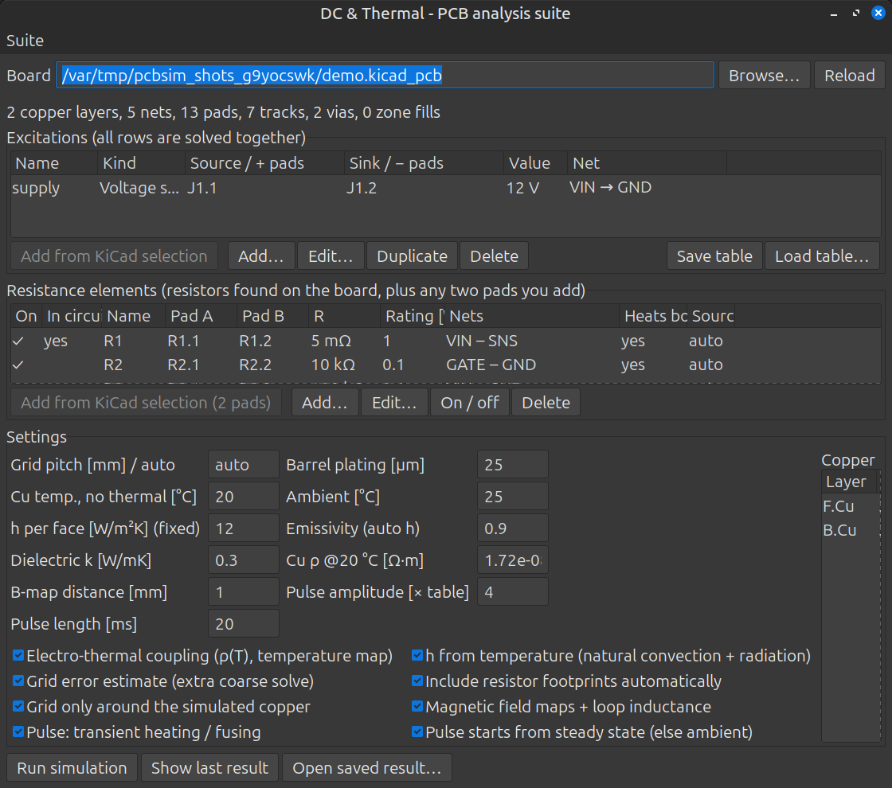

## Trace R/L/C → SPICE

Pick two or more pads on one net and the return nets. The tool follows the copper between the pads (tracks, arcs, vias, stubs), solves the field of every cross-section against the return copper, and builds an RLC ladder.

- Any geometry: microstrip, stripline, coplanar lines, and a GND pour on the other side of a 2-layer board, all from one 2D field solver (within 2 % of Hammerstad–Jensen and Wheeler).
- DC R from the board's real copper (the DC solver), L and C per segment, via L and C, pad C, open stubs.
- Copper pours as real conductors: meshed over their return plane and reduced exactly to R, L and C between everything that touches them.
- Resistors, diodes, capacitors and inductors between any two pads, also across nets (trace → part → trace), with return-net pads as the reference.
- Outputs: per-path totals, a segment table with Z₀ and the return found, the path coloured by Z₀ with impedance steps marked, a drawn schematic of the ladder, and a `.subckt` of plain R, L and C that runs in any SPICE.

## Matching & Tolerance

Build a ladder network in a visual editor: the symbols appear as you add parts, and the plots follow every edit.


| Monte Carlo S11 against the spec | Yield histograms |
|---|---|
| 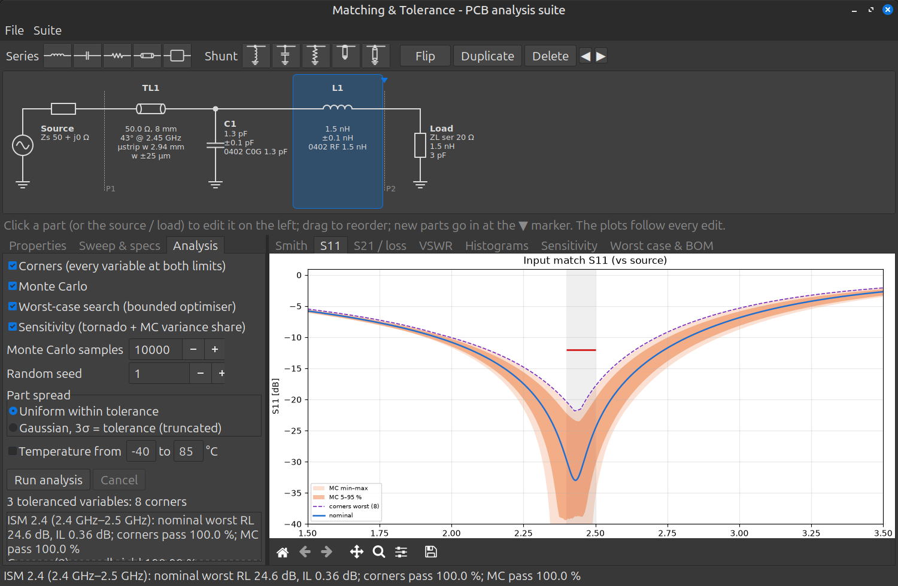 | 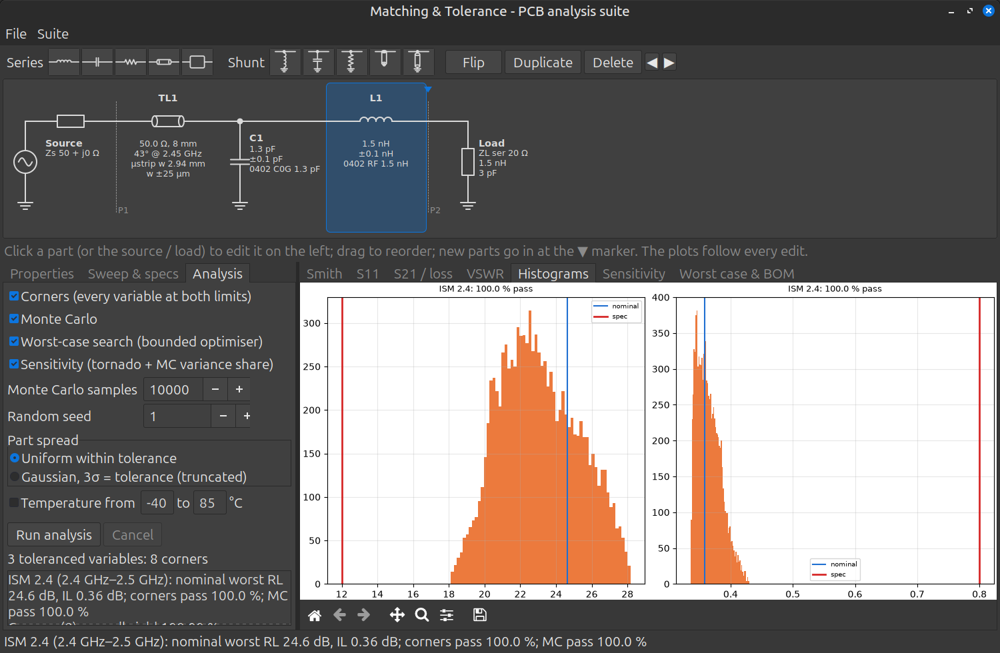 |
| **Smith chart** | **Sensitivity** |
| 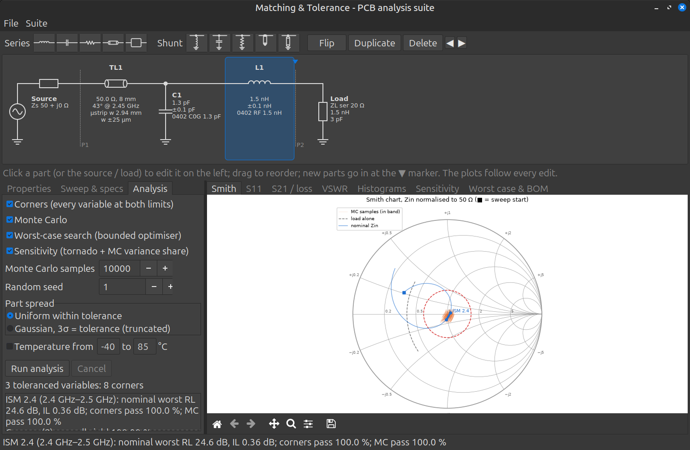 | 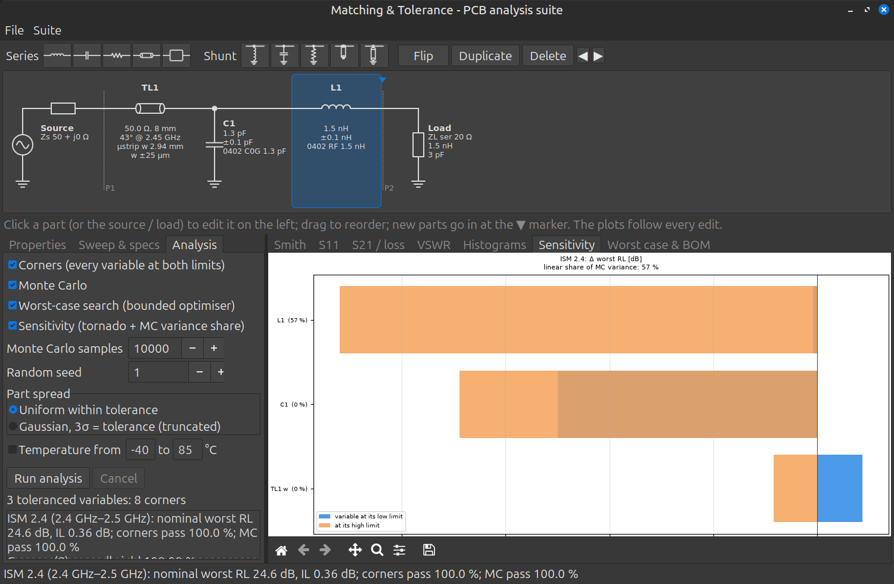 |

- Series and shunt L, C and R, transmission lines (ideal, or microstrip from the board stackup), open and shorted stubs, and S2P two-ports.
- Real parts from a shared component library: tolerance, Q, self-resonance, ESR, ESL, and capacitor drift with temperature and DC bias.
- Source and load as R + jX, an RLC model or a measured `.s1p` file.
- Corners, Monte Carlo (uniform or Gaussian), a worst-case search, sensitivity, yield per band and a BOM.

The screenshot example matches a small 2.4 GHz antenna (20 Ω + 1.5 nH + 3 pF) to 50 Ω. It uses a 1.3 pF shunt capacitor and a 1.5 nH series inductor, both 0402 parts with ±0.1 pF / ±0.1 nH tolerance.

## Shared panels

| Stackup & materials | Component library |
|---|---|
| 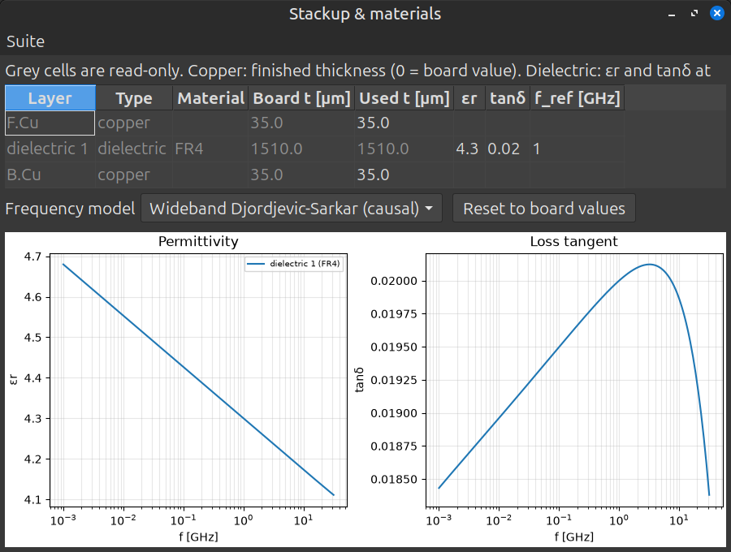 | 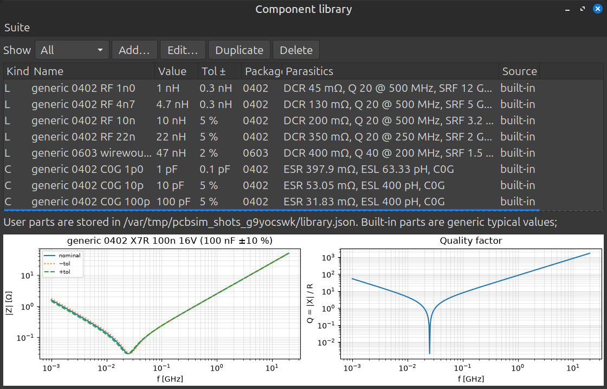 |

## Install

1. Install KiCad 10 and enable the API: *Preferences → Plugins → Enable KiCad API*.
2. Run `kicad_plugin/install.sh`. It finds the plugin folder of a native or Flatpak KiCad.
3. Restart the PCB editor. On first load KiCad installs the Python dependencies (numpy, scipy, matplotlib, plotly, kicad-python), which needs network access.
4. Two toolbar buttons appear: **PCB Analysis Suite** opens the Home window, and **DC & Thermal** opens that tool directly.

Save the board (and refill zones) before running: the tools read the saved `.kicad_pcb` file.

Standalone, without KiCad running:

```sh
python3 -m pcb_current_sim.wxgui board.kicad_pcb --home                        # wx GUI, Home window
python3 -m pcb_current_sim board.kicad_pcb --row "J1.2>J2.2:3" --out results   # command line
```

## Documentation

- [User guide](docs/USER_GUIDE.md): every tool and option, the physical models, outputs and the CLI.
- [Development](docs/DEVELOPMENT.md): environment, tests, smoke tests, screenshots and code layout.
- [Roadmap](docs/ROADMAP.md): the plan for the remaining tools.
- [CLAUDE.md](CLAUDE.md): the detailed design log kept during development.

## Status

- DC & Thermal and Matching & Tolerance work and are covered by tests (`python3 -m pytest tests`).
- Tested in a running KiCad 10 (Flatpak): both toolbar buttons and the KiCad link (pad selection, save, refill).
- Developed and tested on Linux with the KiCad 10 Flatpak.

## License

[GPL-3.0](LICENSE), the same licence as KiCad. You may use, modify and share this software. If you distribute it, or a modified version, you must do so under the same licence and include the source.
