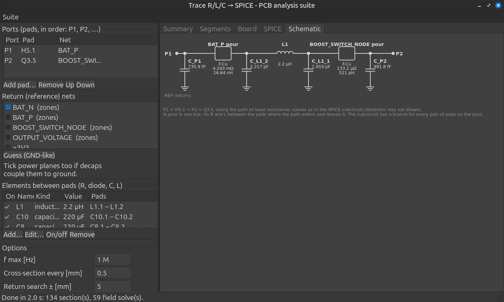
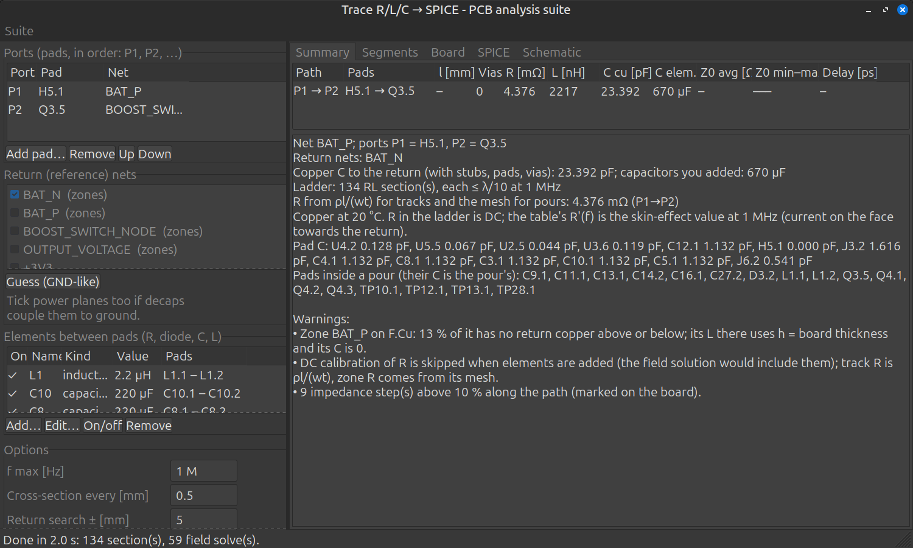
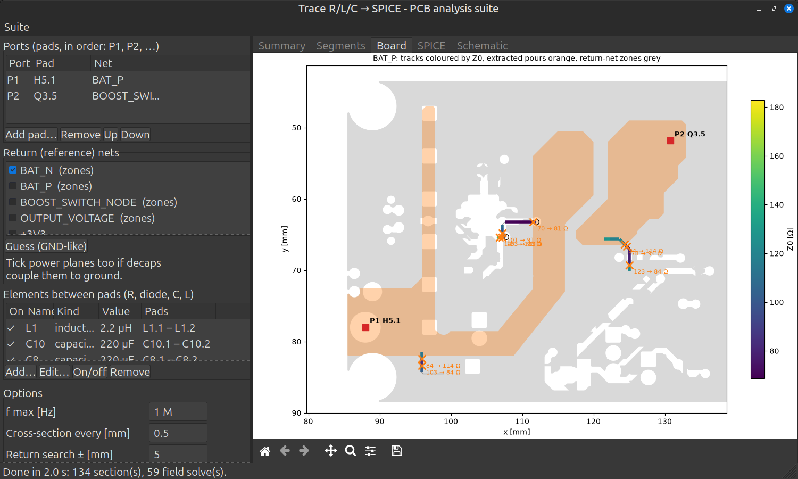
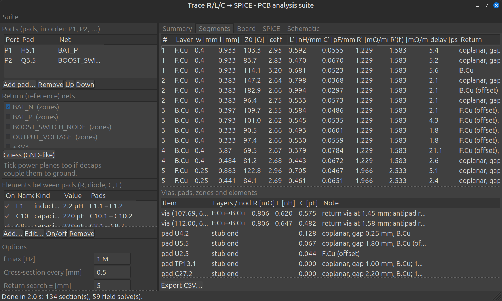
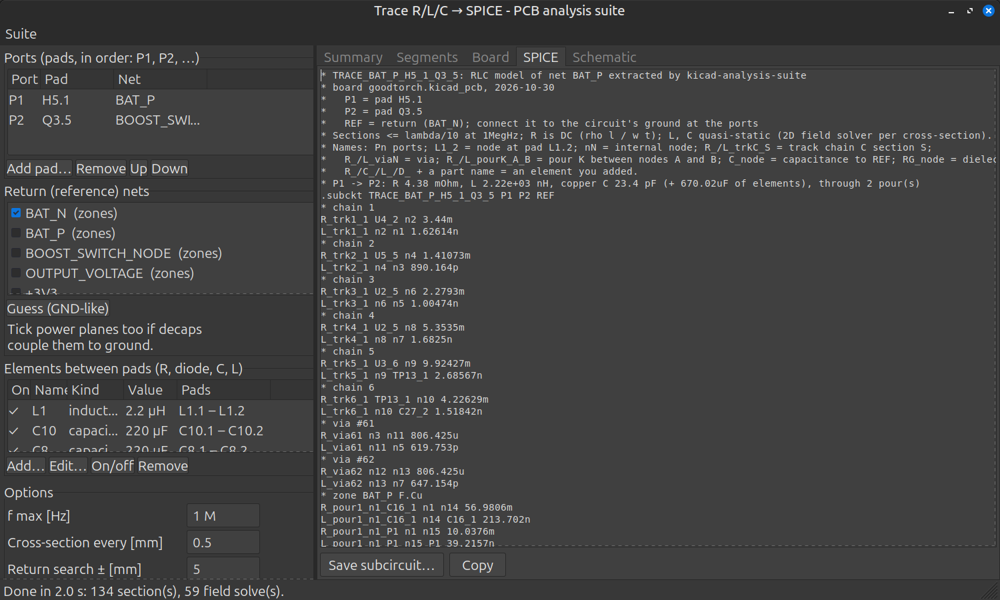

# User guide

The full reference for the PCB Analysis Suite: installation, every tool and option, the physical models, outputs and tests. For a short overview see the [README](../README.md); for development notes see [DEVELOPMENT.md](DEVELOPMENT.md).

## Overview

The suite currently has two tools: **DC & Thermal** and **Matching & Tolerance** (see [Suite](#suite)). The DC & Thermal tool runs a DC simulation of copper nets in a `.kicad_pcb`. For each simulated net it produces:
- current density |J|
- voltage (IR drop), with current paths, loads and voltage sources
- Joule power density
- temperature (2D electro-thermal model), steady and for a current pulse (fusing)
- magnetic field maps above and below the board, and loop inductance

It also builds per-pad, per-via and per-track tables, with IPC-2221 and Onderdonk checks.

## Use

**From KiCad 10 (IPC API plugin, native or Flatpak)**
1. Install the plugin in one of two ways (not both: the two copies would have the same identifier):
   - **Zip package (Plugin and Content Manager).** Run `python3 kicad_plugin/build_pcm.py`; it writes `dist/kicad-analysis-suite-<version>.zip` (`-o DIR` for another folder, `--version X.Y.Z` to override the version).
     In KiCad open *Plugin and Content Manager → Install from File…*, pick the zip and apply. KiCad unpacks it to `3rdparty/plugins/io_github_shrinathn_kicad-analysis-suite/` and can uninstall or update it from the same dialog.
     The package metadata (name, version, licence, minimum KiCad version, `runtime: ipc`) is in `kicad_plugin/metadata.json`; raise its version for each release.
   - **Script.** Run `kicad_plugin/install.sh` (`--link` to symlink instead of copy).
     It finds the Flatpak's plugin folder (`~/.var/app/org.kicad.KiCad/data/kicad/10.0/plugins`) or the native one (`~/.local/share/kicad/10.0/plugins`).
2. In KiCad, open *Preferences → Plugins* and tick **Enable KiCad API**. Then restart the PCB editor.
3. On first load, KiCad creates the plugin's Python venv from `requirements.txt` (kicad-python, numpy, scipy, matplotlib, plotly).
   This needs network access, and the toolbar button appears once it finishes.
   The GUI uses wxPython, which ships with KiCad (Flatpak included). On native installs without wx it falls back to Tk.
4. The plugin adds two toolbar buttons: **PCB Analysis Suite** (the tiles icon) opens the Home window, and **DC & Thermal** opens that tool directly.
   **Save the board and refill zones first**: the simulator reads the saved file.
   The window's "Refill zones + save" button does both through the API.
5. To add a row from KiCad, select pads in the editor (source first, then sink) and click *Add from KiCad selection*.
   Use the selection filter to pick pads rather than whole footprints.

**Standalone GUI:** `python3 -m pcb_current_sim.wxgui board.kicad_pcb [--home]` (wx, DC & Thermal or the Home window) or `python3 -m pcb_current_sim.gui board.kicad_pcb` (Tk, DC & Thermal only)

**CLI**
```
python3 -m pcb_current_sim board.kicad_pcb --row "J1.2>J2.2:3:signal" --row "J2.1>J1.1:3:return" \
        --out results --formats png,svg,pdf,html,csv,npz [--no-thermal] [--pitch 0.05] \
        [--thickness F.Cu=48um] [--ambient 25] [--h-conv 12 | --emissivity 0.9] [--scenario board.current_sim.json]
```
A row is written `SRC>SNK:AMPS[:NAME]`. Join several pads on one side with `+`, for example `U1.3+U1.4>J1.1:5`.
Voltage sources and loads: `--vsource "PLUS>MINUS:VOLTS[:NAME]"`, `--load "PLUS>MINUS:AMPS[:NAME]"`.
Add a resistance element with `--element PAD_A-PAD_B=OHMS[:NAME[:WATTS]][:ext]`, for example `Q1.3-Q1.2=20m:Q1:0.35`.
`:ext` marks an off-board load or wire whose dissipation does not heat the board.
A diode (constant drop) is `--element ANODE-CATHODE=VOLTSv[+OHMS]`, for example `D1.2-D1.1=0.45V+20m:D1`.
Pulse: `--pulse SCALE:MS[:steady]` (all rows × SCALE for MS ms, from ambient or from the steady state).
Other options: `--no-auto-resistors`, `--no-crop`, `--no-magnetic`, `--b-height MM`.

Example board with a shunt, a FET element and pull resistors: `sim/demo/demo.kicad_pcb`
(`python3 -m pcb_current_sim sim/demo/demo.kicad_pcb --vsource "J1.1>J1.2:12:supply" --element "J2.1-J2.2=2.4:LOAD:ext" --element "Q1.3-Q1.2=20m:Q1:0.35" --pulse 4:20:steady`).

## Suite
All windows run in one process and share the loaded board, the stackup and the component library. Every window has a **Suite** menu that leads to Home, the tools and the shared panels.
- **Home** shows the board, its stackup and what the scenario file holds, with tiles for each tool:
  - POWER: DC & Thermal, PDN (AC)
  - SIGNAL & FIELDS: Trace R/L/C → SPICE, SI & Fields, 3D extraction
  - RF / CIRCUIT: Matching & Tolerance, Full-wave (openEMS)

  DC & Thermal, Trace R/L/C → SPICE and Matching & Tolerance are built; the other tiles are marked *planned*.
- **Stackup & materials** shows copper thickness (with overrides) and dielectric thickness, εr and tanδ.
  - εr and tanδ come from the board's stackup, default to 4.3 / 0.02, and can be edited at a reference frequency.
  - Plies inside one dielectric are combined in series. KiCad's `addsublayer` plies are read.
  - The frequency dependence uses the wideband Djordjevic–Sarkar model, which is causal: εr falls slowly with f and tanδ stays nearly flat. A constant model is the alternative.
  - The DC tool's copper-thickness list edits the same overrides.
- **Component library** holds real-part models used by the matching and PDN tools. Each part has a tolerance (± % or absolute; capacitor codes A/B/C/D) and parasitics:
  - L: DCR, Q at f, SRF.
  - C: ESR or Q, ESL or SRF, dielectric with a temperature and DC-bias curve.
  - R: series L, parallel C.

  The panel plots |Z| and Q against f, at nominal and at the tolerance limits.
  User parts are stored in `~/.config/pcb_current_sim/library.json`, which the Flatpak and host installs share. Built-in parts hold generic typical values; duplicate one to edit it.
- **Results browser** lists saved results (`.npz` plus its `.json` sidecar) under the board folder, and the last unsaved run.
- **External tools** looks for openEMS, FastHenry, FastCap and ParaView.
  Inside the Flatpak, host programs can only be run after `flatpak override --user --talk-name=org.freedesktop.Flatpak org.kicad.KiCad`; without that, the 3D tools will export their input files instead.

**Switching Loop** finds the layout parasitics of a hard-switched power stage: the hot loop (switch, rectifier, hot-loop capacitors) and the gate loops.
- **The window at a glance.** Top left, a **cell diagram** drawn from the setup: the supply side (rail) at the top, the return at the bottom, the upper and lower switches with the switch node between them, the inductor, the hot-loop caps (behind any rail link) and each FET's gate drive as a path (driver pin → series parts → gate, source → driver return). Parts with generic values are amber, a missing position red; hover for an explanation, click a part to edit it. Below the lists, **Checks** lists what is wrong or missing, worst first, each with a button that fixes it or goes there: ✖ blocks the analysis (no cap, a switch on the wrong nets, a cell saved before the board changed), ⚠ makes the results doubtful (generic part values, small filter caps counted as hot-loop caps, a FET without a gate drive), ℹ says what more input would give. **Operating point** holds the voltage across the switches and the switched current; the mesh and frequency range sit under "Advanced". After a run the Summary tab starts with **What it means**: the loop rated (under 1 nH excellent, 2.5 good, 5 fair, above high: rules of thumb for SMD power stages), its ringing, the overshoot against the voltage, the three biggest contributors you can change with what to do about each, and per gate whether it rings and what gate R damps it. "Select the loop's parts in KiCad" selects them in the PCB editor.
- **The cell.** Every buck, boost and half-bridge leg is one cell: an upper and a lower switching position between a rail and its return, the switch node between them, and the hot-loop capacitors across rail and return (input caps for a buck, output caps for a boost, bus caps for a bridge). A position may hold parts in parallel (a FET with a Schottky across it). "Topology" only says which position switches actively; "Detect" decides it from the parts.
- **Detect parts.** Pick the switch node (the list puts nets joining an inductor and a transistor or diode first) or select one of its pads in KiCad. The tool finds the FETs and diodes on it (upper or lower from their other net; the return is the GND-like net, else the one with the most pour), the capacitors between rail and return within 20 mm (others listed, switched off), and each FET's gate drive: gate pin, a series resistor if there is one, the driver IC's output pin, and its return pin on the FET's source net (return for a low-side FET, the switch node for a high-side one). Add, remove or switch parts off by hand.
- **Pins.** Found by net, not by pin number: all of a part's pads on one net are one pin (three source pins are one node, which is right: the package joins them; the board current into each pad is still solved). The gate is the FET's net with the fewest pads (ties: the net without a pour and with the fewest connections); drain and source follow the position (N-channel: lower switch drain on the switch node, upper switch source on the switch node). The Parts list shows each part's pins (net and pad numbers); "Edit model…" changes them: the net of each pin, **N- or P-channel** (P swaps drain and source: a P-channel high-side switch has its source on the rail), and **Kelvin-source pads**: ticked pad numbers become their own pin, joined to the die's source inside the package (L Kelvin pin), so the gate driver's return no longer shares the package's source inductance. A Kelvin trace that meets the rest of its net only inside the package is fine: every connected piece of a net's copper gets its own reference. Pads with no net are ignored.
- **Cells, supply side and return.** "Switching cell" shows the cell's switch node, **supply side** (the rail: the net the hot loop closes through opposite the return; a buck's input, a boost's output, a bridge's bus) and **return**; changing the rail or return moves the switching parts' pins and the drivers' return pins with it and searches the hot-loop capacitors again. A board can have several cells (a 4-switch buck-boost has two switch nodes, a full bridge two legs, a board several converters): "New cell…" adds one from its switch node, the Cell list switches between them, each keeps its own setup and result, and all are saved.
- **Gate drives.** Each FET's drive is: the driver's output pin → any number of **series parts** → the gate, returning from the source to the driver's return pin. Detection walks from the gate through two-pin resistors / beads (R, FB, L footprints, up to 4) to a driver IC pin on a net that also reaches the FET's source. "Edit drive…" (or double-click) opens the drive: driver output and return pins (part and net), the driver's output resistance, and the series parts: **Add resistor…** (a resistor or bead footprint, value from the board), **Add element between pads…** (any R between any two pads, as DC & Thermal's resistance elements), Edit (R and package L), Remove, and **Find from the gate** (detect again). The order does not matter: the copper links the parts, so series, parallel or bypassed parts all solve as laid out. "Add drive…" adds one for a FET without, "Remove" drops one. The list shows the parts and Σ R (their values added; the solved gate-loop R is in the results). A gate loop the parts leave open is warned about.
- **Converter ICs (internal switches).** A buck or boost regulator IC with its switches inside: "Detect parts" finds an IC on the switch node and fills the positions that have no external part with the IC's internal switches ("U1 high-side": drain on the IC's input pins, source on its SW pins; "U1 low-side": SW to its PGND pins). The cell's rail is the IC's power net that is decoupled to the return and is not the inductor's far end: a buck IC's input, a **synchronous boost IC's output** (SW → internal high-side switch → VOUT pin, closing through the output cap); among several, the one named like an input (PVIN, VIN, IN, VCC, ...). The return is its GND-like net with the most pins. Separate pins per switch work by net (several SW or PGND pins on one net are one pin; a PVIN pin for the high-side drain is preferred over a VIN supply pin). An async boost IC (internal low-side switch, external diode) or async buck IC (internal high-side switch, external diode) mixes both. Add one by hand with "Add…" → "Internal switch, upper / lower (inside an IC)". Model: R_DS(on), the switch-node capacitance (C_oss) if the datasheet gives it (internal switches take it as entered: 'at V_DS' = 0 means no voltage scaling; C_oss = 0 leaves it out), package L (pin + bond wire, 0.3-1 nH per pin group), and the datasheet's rise / fall times and delays. There is no gate pin, so no gate loop.
- **Rail links.** When the rail reaches its caps only through a 0 Ω resistor, a solder jumper or a net tie (an IC's VOUT pin -> 0 Ω option resistor -> the output net with the caps), Detect adds that part as a **Rail link (0 Ω)** and searches the caps on the far net too. It never follows a link into the switch node, the return or the inductor's far end (a 0 Ω from a boost's VOUT to VIN is a bypass option, not the hot loop). Ferrite beads are not links: at the ringing frequency a bead is a high impedance, so caps behind it are not in the hot loop. Parts marked "do not populate" are ignored. Add a link by hand with Add… -> Rail link. Before meshing, the analysis checks that every enabled hot-loop cap sits across the rail (or a linked net) and the return, and that the switches sit in their positions; a cell saved with older settings may fail that check: press Detect parts.
- **Voltage across the switches.** Under Operating point (the rail voltage): the voltage across the switch that is off. It only sets capacitances that depend on voltage: the switches' C_oss / C_rss and the diodes' C_j (scaled from the datasheet's test voltage, unless 'at V_DS' is 0) and the hot-loop capacitors' DC-bias derating. It does not change any inductance; for an IC with no switch capacitance given it mainly derates the caps. (The transient will also take it as the edge's voltage swing.)
- **Models.** FETs: R_DS(on), C_iss, C_oss, C_rss at the datasheet's V_DS (scaled as 1/√V to "V across the switch"), internal gate resistance, and the package inductance of drain, source and gate (about 0.1-0.5 nH per pin for power packages). Diodes: C_j at a reverse voltage, R_d, V_f, package L. Capacitors: from their Value and package (ESL 0.4 / 0.6 / 0.8 / 1 nH for 0402 / 0603 / 0805 / 1206; 5 nH and 50 mΩ for through-hole), or a library part. Gate resistors from their Value; the driver's output resistance under "Driver R out". FETs and internal switches also take their **rise and fall times** and turn-on / turn-off delays. Generic values are marked and warned about: enter the datasheet's. A diode's V_f is kept for the switching transient (it does not change the loop inductance or the ringing).
- **What it does.**
  1. Window: the parts' pads plus "margin". Pitch: from "Mesh cells" (default 4000) and the copper area; capped so the dense matrices fit in 40 % of the free memory (about 2 GB at 4000 cells, 5 GB at 8000).
     **Adaptive mesh** (default on): a coarse first pass (about 1500 cells) finds where the loop's magnetic energy sits; the cells holding 80 % of it, and every part's pads, are meshed finely, copper within 1.5 mm of them at 2x, the rest at 4x (aligned blocks of fine cells, so connectivity is still decided at the fine pitch). The fine pitch is adjusted until the cell count meets the budget. On a boost converter, adaptive at 4000 cells (14 s) matched a uniform mesh at 8000 cells (53 s).
  2. The copper of every net of the cell (switch node, rail, return, gate and driver nets) is cut into cells; a current bar joins two neighbouring cells of one net (width = the copper across their shared face; a partly covered face carries its bar over its copper), vias and plated holes are vertical bars, and tracks narrower than 1.5 cells are chains of bars along the track at their own angle, joined to the copper under their ends. A part's pads are one node per (part, net).
  3. Partial inductances (PEEC): the exact integral between parallel zero-thickness tapes for near pairs (Hoer & Love), the filament formula for far ones, Neumann's integral for bars at an angle, tubes for barrels. The vertical distance between two layers is the gap between their facing copper surfaces, where the current runs at these frequencies. R from the copper, skin-corrected.
  4. Mesh-current solve (a spanning-tree loop basis): the copper's impedance matrix between the parts' pins at six frequencies, interpolated. Capacitance between nets from potential coefficients of the same cells (one εr for the board: right between layers; coplanar coupling on an outer layer reads up to 2εr/(1 + εr) high).
  5. A small circuit per question: the copper block, the parts with their packages, the drivers.
- **Results.**
  - Per commutation (one position turns off, the current moves to the other): the loop inductance across the switch that turns off, through the copper, the other switch (on) and the capacitors' ESL; "board" is the copper alone, "parts" the packages and ESL. The ringing frequency and Q, from the impedance across that switch with its own capacitance and the board's; overshoot ≈ L·di/dt (L in nH = V per A/ns); a starting RC snubber (R ≈ √(L/C), C ≈ 3 C_oss). With **"Switched current"** set under Options and a fall time on the switch that turns off (or, when a diode turns off, a rise time on the switch taking the current), the table shows di/dt = I / t and the overshoot in volts.
  - "Where the L is": the loop inductance split by magnetic energy: each net and layer of copper, each net's vias, each package pin, each capacitor's ESL. It sums to the total.
  - Gate loops: per FET, the gate-loop inductance (driver pin, gate resistor, gate, source, back to the driver's return), gate ringing with C_iss, and the common-source inductance L_cs, the mutual between the gate loop and the power loop through that FET (shared copper, the package's source inductance, magnetic coupling). V_gs,induced = -L_cs·di/dt slows turn-on and can retrigger at turn-off; a Kelvin source pin brings it down.
  - Impedance: |Z| across the switch and the loop L against frequency (with parts, and copper alone).
  - Map: current density and inductance density per layer at the ringing frequency, drawn on a fine raster of the real copper (about 700 pixels across) with the mesh's values interpolated per net, so copper shapes, clearances and narrow tracks look like the layout; the parts' pads are outlined (hatched: the part carries the current there), grey is copper of other nets or none.
  - SPICE: the copper as coupled inductors between the parts' pins (one R + L branch per pin to its net's reference pin, K couplings, board C between nets), at the ringing frequency.
- **Accuracy.** Checked against closed forms: a wide strip over a plane within 0.4 % of Hammerstad, a plane pair within 0.5 % of image theory, uniform-current plates within 0.1 % of the exact integral, a 1 mm trace over a 1.5 mm plane 3-6 % high (2-4 bars across a trace cannot crowd the current fully to its edges), DC R within 3 % of the DC solver, a via pair and a diagonal narrow track within 5 %. On a real boost converter the default mesh was within 5-10 % of a mesh twice as fine; raise "Mesh cells" to check.
- **Switching edges (transient).** With "Simulate the switching edges" ticked and the inductor current given (Operating point), Analyse also simulates the hard-switched switch turning off (at I + ripple/2) and on (at I − ripple/2), in time. **Which switch is hard-switched** follows the inductor current's direction at the switch node: out of it (a buck, a bridge leg sourcing) → the upper switch; into it (a boost, a bridge sinking) → the lower. Auto decides from the topology, the diodes, or where the feedback divider sits (on the supply side: a boost); the diagram shows it as an arrow and a "hard-switched" tag, and Checks warns when it is a guess. **The circuit:** the extracted copper as coupled inductors and resistors at the ringing frequency plus the board capacitance between nets; each FET as package L per pin, internal R_G, C_gs, voltage-dependent C_gd and C_ds (through the datasheet values at V_DS: c₀/√(1 + V/1 V), rising in forward bias like a junction's), a square-law channel from V_GS(th) and g_fs at a current with its triode slope set by R_DS(on) at its V_GS, and the body diode (V_SD; stored charge Q_rr/I_F for reverse recovery); a diode with V_f, R_d, C_j(V) and Q_rr (0 = Schottky); an IC's internal switch as a conductance ramped (evenly in log) over its rise / fall time (5 ns when not given) with C_oss and a body diode; each driver as a source stepping 0 ↔ its drive voltage behind R out (source / sink; Edit drive…); the other FET held off by its driver; the inductor as a constant current at its switch-node pad; the supply holding the rail behind 50 mΩ + 200 nH at the biggest hot-loop cap. Solved by modified nodal analysis, trapezoidal integration and Newton iterations. **Results (Switching tab):** per edge the peak voltage across the switch that blocks and the overshoot over the supply, the fastest dv/dt and di/dt, the ring's frequency and Q, the energy lost in the switch, the other FET's gate peak against its V_th, and the reverse-recovery current; the switching loss (E_on + E_off) × f_sw; waveforms of V_DS, the currents and both gates (zoomed on the edge: pan / zoom for the rest); CSV export. "What it means" adds a line per edge (✖ when the other gate passes its threshold: shoot-through). Checked: an analytic RLC step, the frequency analysis' ringing frequency and Q (within a few %), the overshoot ≈ L_loop·di/dt, and ngspice running the same equations (peaks within 1 %, energies within 10 %).
- **Saved models.** In Edit model… of a MOSFET, diode or an IC's internal switch: "Save as…" stores its values under the part number (the footprint's Value is suggested; an IC's switches as "<value> high-side / low-side") in `switch_models.json` next to the component library; "Saved models" fills the fields from one. Detect parts applies a saved model to every part with that value, on any board, so a datasheet is entered once.
- **Vendor SPICE models.** In a MOSFET's Edit model…: the manufacturer's model file, the subcircuit (listed from the file), its pin order (D, G, S, T for a temperature pin held at 25 °C, NC; guessed from the pin names, else the usual D G S) and whether the model includes the package (then the package L and R_G fields are left out). The edges then run in ngspice: KiCad's bundled libngspice (or an ngspice program on the PATH); the rest of the circuit is written as SPICE elements with the same equations (the MOSFET channel as a behavioural source, the capacitances as non-conducting junctions with the same C(V), the copper as coupled inductors). "Switching simulator" under Advanced: Auto (ngspice when a FET has a vendor model), Built-in, or ngspice.
- **Limits.** The inductance analysis is small-signal at the operating point; the transient uses the copper at one frequency (the ringing frequency), so skin-effect damping is exact there only, and its copper resistance between ports is diagonal in ngspice. Quasi-static: fine while the loop is much smaller than a wavelength (30 mm is λ/10 at 1 GHz). Copper outside the window and other nets' copper (eddy currents in unrelated planes) are not included. The edge's timing comes from the gate drive (datasheet delays are for reference). Temperature is 25 °C (V_th and R_DS(on) change when hot).
- **CPU use.** The heavy numerics use a third of the CPU cores (4 of 12), not all of them: this PC powered off twice with every core busy. Set the environment variable `PCB_SIM_THREADS` to change it (it applies to all tools).
- **Saving.** The setup goes into the scenario's `loop` section.

**Trace R/L/C → SPICE** turns the copper between pads into an RLC model for a circuit simulator.
- **Ports.** Two or more pads, in order (P1, P2, …): "Add pad…" or "From KiCad selection". P1 is the reference end; totals are given from P1 to each other port. They must be on one net, or on nets that elements join; not on a return net.
- **Return nets.** The conductors that carry the return current (GND-like nets are ticked by default). Tick power planes too when decaps tie them to ground at the frequencies of interest.
- **Elements.** Any two pads can be joined by a resistor, a diode (constant drop Vf plus a series R, conducting from pad A to pad B), a capacitor or an inductor: "Add…" or "From KiCad selection" (two pads). C and L are ideal (no ESR, ESL or SRF). Elements may join nets, so a path can run trace → part → trace. A pad on a return net is the REF node, so a decap from the signal to a GND pad is a shunt C to REF; the GND plane is not pulled in as a conductor. Elements can be switched off without deleting them. With elements present, the DC calibration of R is skipped (the field solution would include them).
- **What it does.**
  1. Traces the copper from P1: tracks, arcs (as polylines), vias (one node per layer, barrel pieces between them), pads, T-junctions, vias and pads sitting on the middle of a track, touching track ends, and copper that overlaps (a via ring on a pad edge, a track end within half its width of a pad). With "Include stubs", branches to other pads stay in as open stubs; otherwise only the paths between the ports are kept.
  1b. **Copper pours.** A zone of the net is a multi-terminal conductor between everything that touches it (pads, vias, track ends). It is meshed (pitch ≥ 0.05 mm, up to 60k cells): each link conducts σ·t through the copper part of the cell face, and has the sheet inductance of copper over its return, μ₀·h per square (h is the dielectric to the nearest return copper above or below; with both, the two in parallel); each cell has C = ε₀εr·A/h to the return. The mesh is reduced exactly onto the terminals (Kron reduction of the conductance network and of the inverse-inductance network), giving an R and an L branch between every pair of terminals; the cells' C is split among the terminals by the harmonic weights of the DC solution. A port or element pad is one terminal over its whole area (the DC solver also ties these to their electrode); any other pad in the pour is copper like the rest of it and is tapped within 0.25 mm of its centre. Treating such a pad as one node would let current cross it for free: on a boost converter's input pour with big THT capacitor pads in it, R read 13 % low that way. Now it is within 2 % of the DC solver; the rest is that the DC solver feeds a plated hole through its barrel, not the whole pad. A 20 × 4 mm pour 1.51 mm over a plane gives ε·A/h and μ₀·h·l/W to within 1 %, and the same R as the DC solver. A pour larger than λ/10 at f max gets a warning with the frequency up to which its lumped model holds; parts without return copper under them use h = board thickness (warned).
  2. Every `sample` mm along each track, cuts the return copper perpendicular to the track within ±`window` mm on every layer (zones and tracks of the return nets; pads and vias are left out as they are short). A 2D finite-volume field solve of that cross-section (dielectrics from the stackup at f max, inner copper embedded in resin, air above and below) gives C′ and, from the same solve in air, L′ = 1/(c²C₀′). Identical cross-sections are solved once.
  3. R′ = ρ(T)/(w·t). "Calibrate R" runs the DC solver from P1 to P2 and scales the ladder's R so that the DC resistance matches the real copper (pads, current crowding, vias).
  4. Vias: barrel R; L = μ₀h/2π·ln(s/r) with the nearest return via at s, else the partial inductance 0.2h(ln(4h/d)+1) nH; C from the antipad radius found in the return planes (Johnson & Graham). SMD pads add C′(pad width) × pad length, less the part of the pad that lies inside an extracted pour (that area's C is already in the pour's mesh); THT pads a via-like C.
  5. Each chain of track pieces between junctions is cut into equal sections no longer than λ/10 at f max (and "Max section"). A section is R + L in series with C/2 to the return at each end (π ladder). "Dielectric loss G" adds ωC·tanδ at f max as shunt resistors.
- **Accuracy.** The field solver is within about 2 % of Hammerstad–Jensen (microstrip) and Wheeler (stripline with thickness). The subcircuit's delay in ngspice matches the extracted delay. IPC-2141 stripline formulas read up to 10 % high for narrow traces; trust the field solve.
- **Outputs.**
  - Summary: per path length, via count, R, L, the copper's C to the return, the C of capacitor elements to the return (kept apart, as a 220 µF cap would hide the pF of the copper), average and min–max Z₀, delay; the R calibration; pad C, and the pads lying inside a pour; warnings.
  - Segments: layer, width, length, Z₀, εeff, L′, C′, R′ (DC) and R′(f) (skin effect at f max), delay and the return found ("In1.Cu", "B.Cu (offset)", "coplanar, gap 0.2 mm", "none in window"). Vias, pads, zones (terminals, area, mesh, C, and R and L of the worst terminal pair) and elements. CSV export.
  - Path totals: R and L are those of the whole network between the ports (zones, elements and parallel paths included; L is the high-frequency loop inductance); C is the copper's shunt C to the return, and capacitor elements to the return are listed separately.
  - Board: the tracks coloured by Z₀, extracted pours in orange, return zones in grey, ports, vias, and steps of more than 10 % in Z₀ marked. "Select path in KiCad" selects its tracks and vias in the PCB editor.
  - SPICE: `.subckt NAME P1 P2 … REF` with plain R, L and C (any SPICE; ASCII; comments on their own lines). A diode element becomes a DC source Vf, a near-ideal diode (`.model DVF D(IS=1e-12 N=0.02)`, about 15 mV at 1 A) and its series R. Connect REF to the circuit's ground at the ports. Names say where each part of the model comes from, so they cannot be mistaken for the board's reference designators: a node at a pad is named after it (`L1_2` = pad L1.2), other nodes are `n1`, `n2`, …; `R_trk3_2`/`L_trk3_2` is section 2 of track chain 3, `R_via12` a via, `R_pour1_A_B` the branch of pour 1 between nodes A and B, `C_<node>` the capacitance to REF at a node, `RG_<node>` dielectric loss, and `R_`/`C_`/`L_`/`D_` + a part name an element you added. A pour has a branch between every pair of pads on it; the weak ones (tens of Ω, µH) are far-apart pads and matter little, but dropping them shifts R by several %, so they are kept. For a path through a pour the summary shows no length, Z₀ or delay.
  - Schematic: the ladder from P1 to P2 along the path of least resistance, drawn with its values, including elements (by their part name; diodes with their own symbol). A pour is one box with its R and L between the pads where the path enters and leaves it. Dielectric loss is not drawn; stubs and other ports show as branch boxes.
- **Example.** A battery boost converter on a 2-layer board, from the battery terminal H5.1 to the FET Q3.5. The path runs through the BAT_P pour, the inductor L1 (an element, 2.2 µH) and the switch-node pour, over a BAT_N plane; the input capacitors are capacitor elements to BAT_N. Result: R 4.38 mΩ (4.24 mΩ in the BAT_P pour, 0.13 mΩ in the switch-node pour), copper L 17 nH besides L1, copper C 23 pF, in 2 s.

  
  
  
  
  
- **Command line.** `python3 -m pcb_current_sim.extract BOARD PAD PAD [PAD…] [--return GND] [--fmax 1G] [-o trace.lib]`.
- **Limits.** Quasi-static: no radiation, no dispersion; good while the cross-section is much smaller than a wavelength (low GHz on normal boards). No coupling to other signal nets (crosstalk is planned with SI & Fields). The ladder's R is DC, so skin-effect loss is not in the time-domain model (R′(f) is reported). Without return copper within the window, L is the trace's partial inductance and C ≈ 0 (red dashed on the board view). Solder mask is not modelled (Z₀ reads 1–3 % high on outer layers).
- **Saving.** Ports, return nets, elements and options go into the scenario's `extract` section.

**Matching & Tolerance** checks whether a matching network still works across real part tolerances.
- **Visual editor.** Symbols appear on the schematic as you add parts from the palette: series or shunt L, C and R, transmission lines, open and shorted stubs, and a two-port from an `.s2p` file.
  - New parts go in at the ▼ marker. Drag a part to move it; right-click it or use the buttons to flip it between series and shunt, duplicate or delete it.
  - Click a part, the source or the load to edit it in the property grid. Every edit redraws the plots.
- **Parts.** Pick a part from the component library or type your own values. Values accept SI prefixes (`4n7`, `2.2p`); tolerances take `5 %`, an absolute value (`0.1 pF`) or a capacitor code (A/B/C/D). "Save part to library…" stores a custom part.
- **Lines.** An ideal line (Z₀, εeff, loss) or a quasi-static microstrip (Hammerstad–Jensen, with conductor and dielectric loss). "Use board stackup" fills in h, εr and tanδ; "Width for Z0…" solves for the width. Tolerances on Z₀, width (etching) and εr are optional.
- **Source and load.** R + jX, series or parallel RLC, or an `.s1p` file such as an antenna's measured S11.
- **Specs.** One or more bands, each with a minimum return loss, a maximum insertion loss and a maximum VSWR.
- **Analyses.** Responses use an ABCD cascade computed for many samples at once (10k samples in about 1.4 s).
  - Corners: every variable at both limits.
  - Monte Carlo: uniform, or Gaussian with 3σ = tolerance (truncated at the tolerance).
  - Worst-case search: bounded Powell, started from the nominal point and the worst corners and samples. Resonant responses can be worst inside the tolerance box, not at a corner.
  - Sensitivity: a tornado chart (one variable at a time) and each variable's share of the Monte Carlo variance. A low total share means the response is non-linear in the tolerances, for example a match sitting at its optimum.
  - Optional temperature sweep, which drifts capacitors by dielectric.
- **Outputs.** Smith chart (nominal, Monte Carlo curves in band, load alone, RL spec circle), S11, S21 with the loss in the parts, VSWR, histograms with yield per band, sensitivity, a worst-case table and a BOM (CSV). The response can also be exported as CSV.
- **Saving.** The network goes into the scenario's `matching` section when a board is open, or into a `.match.json` file. It saves on every run and when the window closes.
- Not modelled: microstrip dispersion and thickness correction, coupling between parts, and pad or via parasitics (add them as elements).

**Highlight in KiCad.** With the suite started from KiCad, clicking parts in a tool's list selects their footprints in the PCB editor: the Switching Loop's parts and gate drives (MOSFET, driver, gate resistor), DC & Thermal's excitations and elements, the Trace tool's ports and elements. Several rows selected (Shift / Ctrl-click) are sent at once. Switch it off with Suite → "Highlight selected parts in KiCad". The schematic editor: kicad-python 0.8 cannot reach it yet (its schematic module fails to import), so the symbols are highlighted only through KiCad's own cross-probing from the PCB editor, if that is on and reacts to API selections; the status bar says what was selected.

**Scenario file.** `<board>.current_sim.json` (version 2) has one section per tool: `stackup`, `dc`, `matching`, `extract`, `loop`, and later `pdn` and so on.
Each tool rewrites only its own section. Version-1 files load as the `dc` section, and their copper-thickness overrides move to `stackup`.

## Model
- **Excitations.** Every row of the table is applied **at the same time**. A row is one of:
  - *Current path*: +I at the source pads and −I at the sink pads.
  - *Load*: draws I out of the copper at its + pads and returns it at its − pads (an IC, a motor). The table shows the voltage the load actually sees.
  - *Voltage source*: holds V(+) − V(−) (a regulator or supply). It is a Norton equivalent with 10⁶ S, so the error is 10 µV at 10 A. Its current is set by the loads and resistance elements on it.
  - A shared return path therefore carries the sum of the row currents.
  - The pads on one side of a row are tied together as a single equipotential.
  - For a THT pad, the electrode is its plated barrel on every layer. For an SMD pad, it is the pad area.
  - Each row reports ΔV and R_eff = ΔV/I. When rows share copper, ΔV includes the drop caused by the other rows.
- **Resistance elements.** A lumped resistance joins two pad electrodes, which may be on different nets.
  - Resistor footprints (reference `R…`/`RS…` or a `Resistor_*` library, exactly 2 pads, not DNP) are found automatically.
    The value is read from the Value field (`10k`, `4k7`, `0R1`, `R005`, `5m` = milli, `1M` = mega), and the power rating is guessed from the package (0603 = 0.1 W … 2512 = 1 W, DIN0207 = 0.25 W).
    Parts that can't be read (4-pad Kelvin shunts, odd values) are listed as warnings.
  - Any other part can be added by picking two of its pads and entering R and an optional rating: a FET's R_on, an inductor's or ferrite's DCR, a fuse, or a load or wire between two connectors.
  - Only elements that can carry current are used: starting from the rows' nets, enabled elements pull in further nets, and dead-end nets (reached through one element only and not excited) are dropped.
  - Each element's I²R heats its two pads in the thermal model. The Elements table shows R, I, V, P and P against the rating.
  - With current excitation, an element that bridges two separately excited loops (for example a bleeder across the supply) carries ≈0 A, because nothing sets the voltage between the loops.
  - 0 Ω parts are ideal links (1 µΩ). TCR and Kelvin sensing are not modelled.
  - **Constant voltage drop (diodes).** In the element dialog, choose *Constant voltage drop* instead of *Resistance*: the element is Vf in series with a resistance (0 allowed), and conducts only from pad A (anode) to pad B (cathode).
    - It blocks while V(A) − V(B) < Vf. The solver starts with all diodes conducting, turns off any that carry reverse current, turns on any blocked one forward-biased past Vf, and repeats until the states are consistent (also on every electro-thermal iteration).
    - It dissipates I·(Vf + I·R), which heats its pads like a resistor. The Elements table shows its value as `0.45 V → + 20 mΩ` and whether it conducts.
    - A current row forced through a blocking diode is an error (open circuit), with the diode named. A zener in breakdown is a constant-drop element with its pads swapped.
    - Vf does not change with temperature or current beyond the series R; for the inductance calculation a conducting diode counts as its series R.
- **Speed.** By default the electrical grid covers only the bounding box of the simulated copper, snapped to the whole-board lattice, so the result is identical.
  - The thermal grid adds 20 mm of board around it (`thermal_margin`), and its cut edges are adiabatic.
  - **Thermal cell** (setting, default 0.3 mm; 0 = as fine as 300k cells per layer allow). Heat spreads over millimetres, so this is much coarser than the electrical grid. Each cell's copper fraction is the union of all copper in it, sampled at about 30 µm. On Magnus_Gateway, 0.3 mm reads T_max 1.6 K (2 % of the rise) below a 0.18 mm grid and runs 3× faster; on the demo board 1.1 K of 130 K. Coarser cells read slightly cool, because a trace and the pour next to it share a cell once the cell is wider than their clearance. Short pulses get their own finer grid (≤ a tenth of the heat's reach).
  - All sparse solves go through `linsolve.py`: SuperLU with a symmetric minimum-degree ordering, or Intel PARDISO when `pypardiso` is installed in the plugin's venv (optional, about 1 GB of MKL; about 10× faster factorisation of large thermal grids; `PCB_SIM_SOLVER=superlu` turns it off). Iterative multigrid is not used: on copper-next-to-FR4 matrices it was 50× slower and up to 8 % off.
  - Independent work runs in parallel threads: the thermal model is built while the electrical system is solved, the error-estimate solve runs alongside the electro-thermal loop, and the B maps alongside the inductance solve. FFTs use all cores.
  - The copper raster and the thermal model are cached. Running again on the same board with other currents, voltages, ambient or emissivity skips their setup; reloading the board or changing copper thickness, h, k or the thermal cell rebuilds them.
  - Magnus_Gateway (thermal, error estimate, B maps): 24 s before these changes, 8 s now, 4.6 s on a re-run. A 0.7 M-node electrical grid solves in about 5 s.
- **Geometry.** The tool reads:
  - tracks and arcs on all copper layers
  - vias, with barrel resistance R = ρL / (π·t_plate·(d + t_plate))
  - filled zones
  - pads: rect, roundrect, oval, circle, trapezoid, and custom (anchor plus polygons), including footprint rotation
  - drills, which are removed from the copper
- **Copper thickness and dielectric gaps** come from `(setup (stackup))`. If the file has no stackup, the tool uses 35 µm copper and the board thickness split evenly.
  Override the thickness per layer if your fab's finished outer copper is thicker (often 45–60 µm after plating).
- **Discretisation.** The tool uses a cut-cell finite-volume grid: each link conducts through the copper fraction of the shared cell face, sampled 4×4.
  - Axis-aligned and 45° tracks both converge to within 1–2% at 8 cells per track width.
  - With the error estimate enabled, a second solve at twice the pitch gives a ± error for every row.
- **Thermal model.** Each copper layer is a thermal sheet: copper of all nets plus a share of the dielectric.
  - Sheets are coupled through the dielectric and through the copper barrels of all vias and plated holes.
  - Both outer faces lose heat to ambient. By default h comes from the local surface temperature: natural convection of a vertical plate, 1.42·(ΔT/L)^0.25, plus radiation εσ(T⁴ − Ta⁴)/ΔT with ε = 0.9. That is about 11 W/m²K at a 10 K rise and 18 W/m²K at a 100 K rise. Untick "h from temperature" (CLI `--h-conv 12`) to use a fixed h.
  - Element I²R is spread over the area of its two pads, not put into a single cell.
  - The solver iterates ρ(T) = ρ20·(1 + 0.00393·(T − 20)) until T stops changing (Picard iteration).
  - If the copper would exceed its melting point, it stops and flags **thermal runaway**.
  - It does not model component self-heating, enclosures or airflow.
- **Current density J** comes from the face-normal fields (E/ρ), averaged per cell. The viewer can draw streamlines.
- **Magnetic field.** Biot–Savart from the solved currents: sheet currents per layer (FFT convolution), vertical barrel currents and resistance-element bodies.
  It is shown on a plane `b_height` (default 1 mm) above the top surface (top layer view) and below the bottom surface (bottom layer view), as |B| and the normal component Bz (up), with Bx, By and Bz in the cursor readout.
  Only the board's own currents are included; external wiring is not.
  Checked against an infinite strip (within 1 %).
- **Loop inductance.** Each row is driven alone with 1 A (other current sources open, voltage sources shorted).
  The partial inductance matrix L_mn = μ0/4π ΣΣ m_m·m_n/R is computed over the current moments, with the exact cell self-term and Gauss quadrature for near cells. Barrels use Grover's parallel-filament formula.
  Each loop is closed by a straight line from the pads where the current leaves the copper back to where it enters (the source or component). Define rows so that this closure is short: a capacitor's two pads, a connector's pins, or a voltage source with its load as an element.
  It uses the DC current distribution; at MHz the return current hugs its track and L drops a little. Checked against Grover for a hairpin (within 4 %).
- **Pulse (transient).** All rows × `pulse_scale` for `pulse_ms`, starting from ambient or from the steady state, using implicit Euler.
  Heat capacity is copper plus the FR4 the heat can reach (0.886·√(αt), re-lumped with energy conservation as the pulse goes on).
  ρ(T) is coupled; the electrical problem is re-solved every 20 K.
  The pulse uses its own thermal grid: the copper plus 3·√(α_cu·t) of board.
  The FR4 capacity growth is applied every step as an energy-conserving sink C′(t)·φ, so T(t) is smooth. The default is about 1.6 % conservative against the converged result.
  The tool reports the hottest point over time, the time to melt if the copper melts, the T map at the end, and the peak T per track.
  Validation: with FR4 removed it reproduces Onderdonk (10.03 ms against 10 ms). With FR4, a 1 mm 1 oz trace lasts about 1.8× longer (18.2 ms converged, 17.9 ms at the default steps).
  Resistance elements heat their pads; their body heat capacity is ignored, which errs on the hot side.

## Outputs
- **Viewer.**
  - Pick the layer and the quantity: |J|, V, T, power density, |B|, B normal, or T at the end of the pulse.
  - The cursor readout shows each quantity at the pointer.
  - Click the map to set a ΔV reference point.
  - Selecting a table row marks its location on the map.
  - Resistance elements are drawn as dashed yellow links.
  - **3D tab** (wx viewer): an interactive Plotly scene in an embedded web view (WebKitGTK).
    - Each copper layer is a sheet at its stackup height (z exaggerated), coloured by |J|, V, T, power density or end-of-pulse T. Vias and barrels are vertical bars coloured by current.
    - It also shows the resistance elements, the board outline, and the B-normal planes above and below.
    - Drag to rotate, scroll to zoom; hover shows values. *Open in browser* and *Save 3D HTML…* give a self-contained page that works offline.
    - The Tk viewer opens the same scene in the browser. On the CLI it is `--formats html3d`.
    - It is a visualisation of the 2.5D results; the solver itself is not 3D.
- **ParaView.** The *ParaView…* button or `--formats vtk` writes a folder you can open in ParaView. It uses VTK XML (zlib, base64), written with numpy only.
  - `board.vtm` is a multiblock with the copper sheets at their true heights (|J|, J vector, V, power density, copper fraction, net id), the thermal sheets (T and end-of-pulse T), the B planes (B vector, |B|, Bz), and line sets for the vias (current), elements (I, P, R) and outline.
  - `pulse.pvd` is the pulse temperature as a time series of 20 frames that ParaView animates.
  - Axes: x right, y up (KiCad y flipped), z up with the top copper surface at 0, true scale. Use *Transform* to scale z.
  - `README.txt` in the folder lists useful filters: Threshold, Glyph on J_vector, Contour on V, Plot Over Line.
  - Install ParaView with `flatpak install flathub org.paraview.ParaView`.
  - Checked by reading every file back with VTK 9.7's XML readers.
- **Exports.** You can export:
  - the current view as PNG, SVG or PDF
  - every layer as images
  - a multi-page PDF report (summary, tables, maps)
  - the tables as CSV
  - an interactive Plotly HTML page
  - the result as `.npz` + `.json`, which can be reopened later
- **Tables.**
  - Excitations.
  - Pads: role, current, V, T.
  - Vias and barrels: current, IPC capacity, parallel-via groups and each via's share.
  - Elements: R, I, V, P, rating use and pad temperature.
  - Inductance: self L per row, mutual M and coupling k between rows, closure length.
  - Pulse: hottest temperature over time (also plotted in the PDF report).
  - Loss ranking per copper item: P, share of the net's loss, ΔV, I, crowding factor, IPC-2221 use at 10 °C and 20 °C, and Onderdonk fusing time.

## Tests
`python3 -m pytest tests`. The tests cover:
- analytic straight, arc and via resistances
- rotated footprints
- parallel vias
- a shared return path
- error cases
- 45° tracks against axis-aligned ones
- the analytic thermal sheet, the automatic h against the heat balance, via barrels coupling the layers, element heat spread over pads
- scanline zone fill against matplotlib's point-in-polygon test
- IPC and Onderdonk formulas
- voltage source with a resistive load, load voltage against IR drop
- B above and below a strip, hairpin loop inductance against Grover, Grover filaments
- adiabatic pulse against Onderdonk, and a pulse from steady state that leaves T unchanged
- resistor values and ratings, a series resistor across nets, parallel resistors sharing by conductance, a user element on a 3-pad part with dead-end pruning, cropped against full-board grids, and element heating
- matching (`tests/test_matching.py`): an L-match is matched and lossless; Q loss in the inductor; a quarter-wave transformer; quarter-wave open and shorted stubs; a 50 Ω microstrip on FR4; Touchstone formats and S → ABCD; an S2P element equal to a series inductor; corners, Monte Carlo yield, Gaussian against uniform, the worst case at least as bad as corners and samples; the temperature variable on X7R; setup round trip and the BOM
- suite (`tests/test_suite.py`): stackup plies and `addsublayer`, the Djordjevic–Sarkar fit and its causality, scenario v1 → v2 migration with sections kept, stackup overrides persisting across sessions, SI value parsing, L/C part models (SRF, Q fit, DC bias, Monte Carlo broadcasting), and the library round trip

## Layout
`pcb_current_sim/` holds the core: `sexpr`, `board`, `elements`, `raster`, `solver`, `thermal`, `magnetic`, `results`, `export`, `vtk_export`, `cli` and `scenario`.
It also holds `kicad_link` (the kipy wrapper), `tables` (helpers shared by both GUIs), `wxgui/` (the wx app and viewer, used inside KiCad) and `gui/` (the Tk app and viewer).
`pcb_current_sim/matching/` holds the matching tool's core: `model` (elements, ports, bands, ABCD cascade), `analysis` (corners, Monte Carlo, worst case, sensitivity, BOM), `touchstone`, `microstrip` and `plots`. `wxgui/matching.py` is its window and `wxgui/schematic.py` the symbol canvas.
`pcb_current_sim/suite/` holds the toolkit-neutral suite core: `session` (shared state and change events), `stackup`, `library`, `tools` (the tool registry), `external` (solver detection) and `results_index`. `wxgui/suite.py` holds Home, the Suite menu and the shared panels.
`kicad_plugin/` holds the KiCad plugin files: `plugin.json` (two actions), `_bootstrap.py`, `home.py`, `action.py`, icons, `install.sh`, and the PCM package files `metadata.json` and `build_pcm.py`.
`sim/demo/` holds the demo board and four wx smoke tests: `smoke.py` (main window and viewer), `smoke3d.py` (3D tab), `smoke_suite.py` (Home, the shared panels and the DC window) and `smoke_matching.py` (builds a network in the editor, runs every analysis and screenshots every tab). The last two work on a copy in `smoke_out/`, and `smoke_suite.py` clears that folder first. Run them with the plugin venv's python inside the Flatpak; they write screenshots next to themselves.
